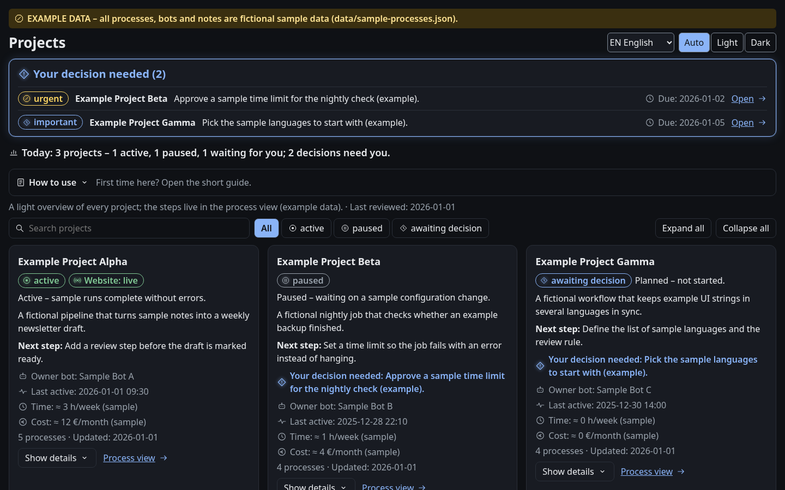
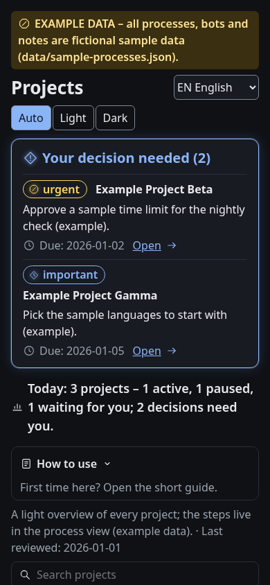
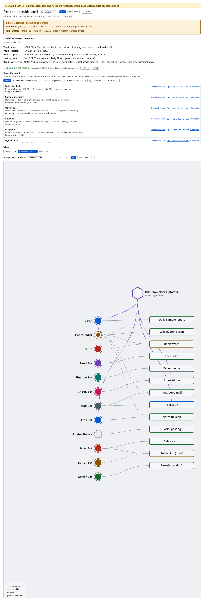
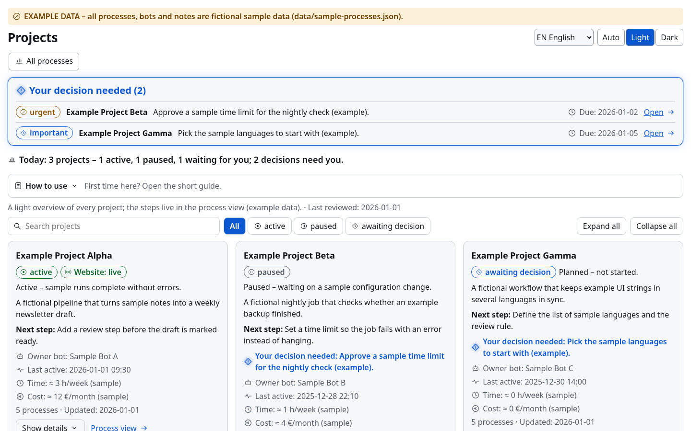

# Process Dashboard (example)

<p align="center"></p>
<p align="center"></p>

> **All data in this repository is fictional EXAMPLE data** (`data/sample-processes.json`). No real bots, people or systems are described.

A single-page React + TypeScript (Vite) dashboard for automated processes: owner bot, schedule, status, last run, problem, category and details, plus an Obsidian notes panel. All data is static in the source; the page makes no network calls.

Other languages: [Magyar](docs/README.hu.md) · [Deutsch](docs/README.de.md) · [Français](docs/README.fr.md) · [Português](docs/README.pt.md) · [Italiano](docs/README.it.md) · [中文](docs/README.zh.md) · [日本語](docs/README.ja.md) · [Español](docs/README.es.md)

## Quick start
```bash
npm ci && npm start      # builds, then serves on http://localhost:4173
```
Requires Node 18+. Development server: `npm run dev`.

## Install and run (step by step)
**Prerequisites:** Node.js 18 or newer (with npm) and Git. The optional vault tools (`tools/vault-read`, `tools/gen-recent`) need Python 3.8+ (standard library only).

**Platforms:** Linux, macOS and Windows (CI matrix: Node 18/20/22). On Windows run the tools as `python tools\vault-read ...`; tests use `$PYTHON` if set.

```bash
git clone <your-repo-url> ops-dashboard   # or copy the folder
cd ops-dashboard
npm ci                # install exact dependency versions
npm run dev           # dev server with hot reload (URL shown in terminal, usually http://localhost:5173)
npm test              # run the Vitest test suite
npm run build         # type-check and build into dist/
npm start             # build, then serve dist/ on http://localhost:4173
```

**Where to edit the sample data**
- Processes: `data/sample-processes.json` (loaded by `src/data.ts`).
- Projects: `data/sample-projects.json` (loaded by `src/Projects.tsx`). Each project has `id`, `name`, `summary` (the short line), and `what`, `why`, `status`, `next`, shown when you press **More** on the card.
- Obsidian sample excerpts: `src/obsidian-adapter.ts`.

All shipped data is fictional. Never commit real names, emails, IPs, logs or keys.

## Controls
- Header: language picker (9 languages; ◐ = partial machine translation), theme (Auto / Light / Dark), README.
- Red and amber banners jump to the affected card.
- Views: 24-hour clock, bot–process network, metro lines. Zoom, Fit, Full screen (Esc).
- Cards: "Description / Command" with more / less.
- Projects section: each card shows a short line; **More** (a button with `aria-expanded`) reveals what it is, why, status and next step.
- Stop / Restart copy a message such as `Stop: <process> (Bot A/<id>)` to paste into the Coordinator chat. Nothing is sent.

## Why Obsidian / Why the vault reader
The Obsidian vault is the team's shared knowledge base: decisions, procedures and context live there as plain Markdown notes. The vault reader accesses it read-only, so bots can search it and use what is already written instead of asking again. That saves time and energy, and the owner does not have to re-explain things.

**Principle: knowledge base first, then ask the owner.** Before asking the owner, a bot searches the shared knowledge base read-only and asks only if the answer is not there.

## Configuration
- `.env` (git-ignored, see `.env.example`): `VAULT_PATH`, `VAULT_EXCLUDE`, `VAULT_WRITE_ENABLED`, webhook settings.
- `config.local.json` (git-ignored, copy from `config.example.json`), or any file named by `OPS_CONFIG`:
  - `vault.excludes`: extra folder/file names the vault tools never read or write;
  - `vault.sections`: folder prefix → category map used by `tools/gen-recent`;
  - `vault.titleOnlyKinds`: categories shown title-only (no content summary);
  - `leakScan.terms`: private words that must never appear in the repository (checked by `npm test`; `LEAK_TERMS` overrides).

## Obsidian setup
1. Install Obsidian (obsidian.md) on the machine where you want to read.
2. Open the vault "example vault" (Open folder as vault). The vault host comes from config (`vaultHost`).
3. On another machine: sync the folder (Syncthing, an SMB share or Obsidian Sync) and open it with the same vault name.
4. Press Refresh on the Obsidian panel.

Connect your own vault (placeholders only):
- Vault name: `<your-vault-name>`
- Machine: `<host where the vault lives>`
- Sync mode: Obsidian Sync / iCloud / git / local only
- Connect: set `VAULT_PATH` in a git-ignored `.env`, then run `tools/vault-read`
  `VAULT_PATH=/path/to/<your-vault-name>`

Links use `obsidian://open?vault=<encodeURIComponent(vault)>&file=<encodeURIComponent(path without .md)>` and open in a new tab, because sandboxed iframes block custom-protocol navigation in the same frame.

## Obsidian vault reader (CLI, read-only)
`tools/vault-read` is a dependency-free Python 3 CLI that reads Markdown notes from an Obsidian vault. Read commands never change the vault (for logged writes see the write mode section below). It blocks `..` traversal and symlinks leading outside the vault, skips a built-in exclude list (`.obsidian`, `.trash`, `.git`, wallet/crypto-related names and more; add your own via `VAULT_EXCLUDE`), and redacts lines that look like secrets.

Set the vault path only in the environment or a git-ignored `.env` (see `.env.example`):

```bash
export VAULT_PATH="/path/to/your/vault"
tools/vault-read count
tools/vault-read search project plan --limit 5
tools/vault-read read "Notes/Example.md"
tools/vault-read recent --hours 24          # read-only: changed notes + who wrote them (v1.7.0)
tools/vault-read audit --hours 24           # read-only: exit 1 if any change has no known writer
tools/vault-read list Notes
tools/vault-read tags project
tools/vault-read --json search project
```

## Vault write mode (v1.6.0)

**Kill-switch (v1.6.1):** writes (`create`, `append`, `--pending`, `approve`) run only when `VAULT_WRITE_ENABLED=1` is set in the env or `.env`; default is off, `pending list` stays read-only.

`create` makes a new note and fails if it exists; `append` adds to an existing note only. No delete, overwrite or rename. `--bot <name>` is required; text comes from `--text` or stdin. Every write is logged in `_bot-writes/log.md` (append-only: time, bot, command, path, first 200 characters, sha256) and summarised daily in `_bot-writes/daily/YYYY-MM-DD.md`. `--pending` stores the write in `_bot-writes/pending/` without touching the target; only the owner applies it with `approve <id>`. Excludes, traversal/symlink blocks and secret redaction apply to writes too; `.obsidian` and excluded paths are never written.

```sh
tools/vault-read --json create "Inbox/Note.md" --bot <bot-name> --text "..."
echo "..." | tools/vault-read --json append "Inbox/Note.md" --bot <bot-name>
tools/vault-read --json append "Inbox/Note.md" --bot <bot-name> --pending --text "..."
tools/vault-read --json pending list
tools/vault-read --json approve <id>   # owner only
```

## Config adapter
`src/obsidian-adapter.ts` holds `OBS_CFG` (`vaultHost`, `vaultName`, `source`) and read-only sample excerpts. `source` is `local`, `syncthing`, `smb` or `rest` (Local REST API URL, placeholder only). Override with `VITE_OBSIDIAN_HOST`, `VITE_OBSIDIAN_VAULT`, `VITE_OBSIDIAN_SOURCE` in a git-ignored `.env`. `src/webhook.ts` is a disabled stub for direct process control.

## Beginner guide: one process, step by step
1. Run `npm ci && npm start` and open http://localhost:4173.
2. Under **View**, pick **Bot–process network**. In the bot filter choose **Coordinator**.
3. Click the **Weekly trend scan** box. The detail card shows: schedule Monday 10:00, status active · OK, last run 10-26 10:04.
4. Open **Description / Command** with **more** to read the sample instruction.
5. Press **Stop**. The text `Stop: Weekly trend scan (Coordinator/p02)` is copied. Paste it into your Coordinator chat; the page itself sends nothing.
6. Switch the language in the header and press **README** to read this guide in that language.

## Data
Replace `data/sample-processes.json` with your own export (same shape). Never commit real data or keys.

## Screenshots

Generated with Playwright from the sample-data build (fictional data only, UI in English unless noted).

| | |
|---|---|
|  | The whole dashboard on one long page. |
|  | Header with language picker, theme switch and README button, plus the stale/blocked banner and the Obsidian notes panel. |
|  | The dashboard on a phone-sized screen (390 px). |

## Vision

## Security
See [SECURITY.md](SECURITY.md).

## License
[MIT](LICENSE)
